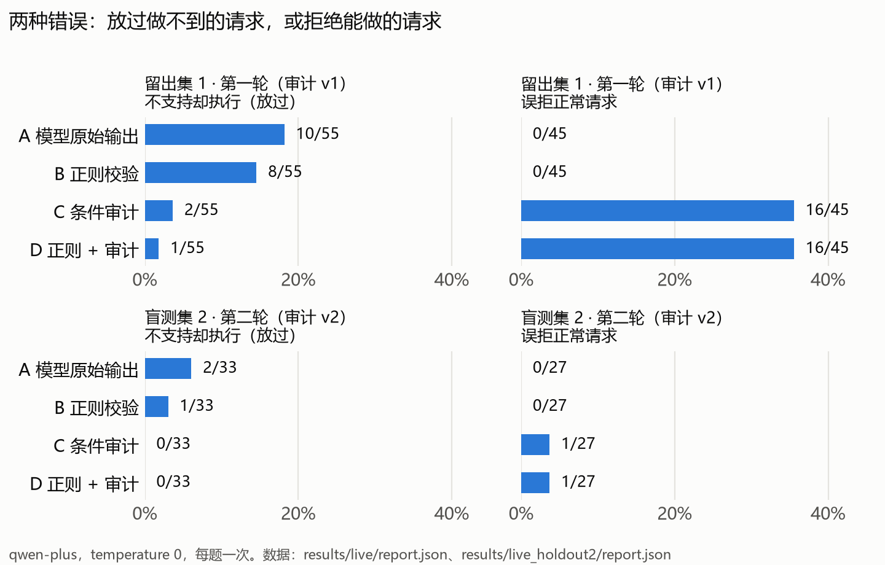
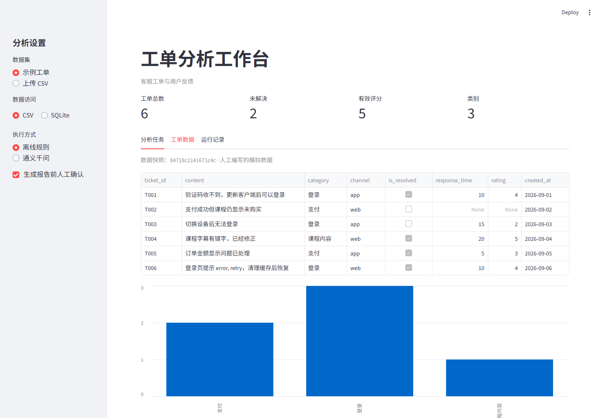
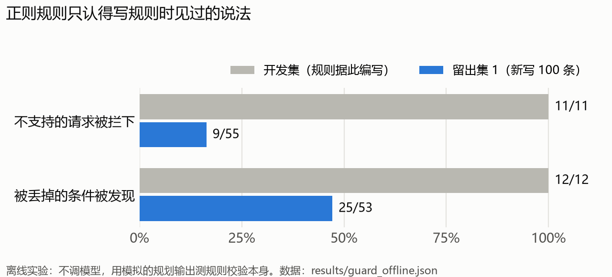

# agent-tool-boundary-eval

**工具调用 Agent 的边界判断：哪些请求该执行，哪些该拒绝或追问。**

一个工单数据分析 Agent：用户一句话提出统计需求，模型选任务、抽参数，程序执行统计。难点在于，模型会对做不到的请求照样调用工具，或者悄悄丢掉一个筛选条件，返回一份格式正确、内容却答非所问的结果。这个仓库记录了怎么评测这类问题、怎么归因，以及为什么最后没有切换默认策略。

> 个人项目，以公开课程的 Agent 项目为学习起点。数据和题目全部自编，模型为 qwen-plus。详见文末「边界」。

## 关键发现

1. **在调规则用的题上测，结果会骗人。** 正则校验在原 20 条题上是 20/20；换成新写的 100 条留出集，55 条不支持的请求只拦下 **9 条**，被悄悄丢掉的条件也只发现 25/53。
2. **模型本身比兜底规则强，漏网的有规律。** 联网时，模型自己拒掉了 55 条不支持请求中的 45 条，正则只多拦下 2 条。剩下的 8 条里有 7 条属于三类：按数据范围自行补年份或换算相对日期、复合请求只做一半、同义词加错别字的多类别请求。
3. **「条件审计」能堵住漏网，但判定表本身也会错。** 做法是让模型列出请求里的每个条件和动作，由程序查表判断能不能执行。加上它以后，放过的不支持请求从 8/55 降到 1/55，却误拒了 16 条正常请求。逐条看，全是判定表的设计错误。修正后在冻结的 60 条盲测集上，它与正则打平（**59/60**），各错一条。
4. **打平时不切换默认策略。** 正则错的那条，是把「3 号到 5 号」悄悄补成 8 月后照常出结果；审计错的那条，是把「所有工单」当成未知类别多问了一句。后者和第一轮的「全部工单」是同一个问题换了说法，说明按词修补判定表也会泛化不足。差距只有 1 条，默认仍用调用成本更低的正则方案。



每条结论对应的失败样本见 **[docs/CASES.md](docs/CASES.md)**。

## 系统怎么工作

流程分五步：规划 → 执行 → 核验 → 人工确认 → 出报告，用 LangGraph 编排。模型只负责选任务、抽参数（千问 Function Calling），可选的任务只有三种只读统计：类别概览、未解决工单、评分分析。所有数字都由程序用模板化 SQL 或 pandas 计算，模型不写 SQL，也不直接给数字。

工具调用执行前还有一层条件检查，由环境变量 `CONDITION_CHECK` 切换：

| 取值 | 做法 | 每个请求的模型调用 |
|---|---|---|
| `regex`（默认） | 正则核对类别、日期、状态等显式条件（`src/intent_guard.py`） | 1 次 |
| `audit` | 条件审计：模型列出全部条件和动作，程序查表判定（`src/condition_audit.py`） | 2 次 |
| `both` | 两者都要通过 | 2 次 |



运行方式、数据格式、请求幂等等工程细节见 [docs/ENGINEERING.md](docs/ENGINEERING.md)。

## 评测怎么设计

| 文件 | 用途 | 规模 |
|---|---|---|
| `data/intent_benchmark.json` | 原评测集，规则就是照着它写的 | 20 条（9 可执行、11 应拒绝或追问） |
| `data/intent_benchmark_v2.json` | 上面 20 条作开发集 + 新写的留出集 1 | 留出集 100 条（45 可执行、55 应拒绝或追问） |
| `data/intent_holdout2.json` | 盲测集 2，decision-v2 定稿后编写，冻结后才运行 | 60 条（27 可执行、33 应拒绝或追问） |

- **标签：** 每条题都打了标签，包括同义改写、口语、中文日期、错别字、渠道、阈值、排除、写操作、外发、注入、相对日期、未知类别、含糊请求等，失败可以按标签拆开看。
- **判分：** 可执行的请求，要求任务和参数（类别、起止日期）完全正确；做不到或需要追问的请求，要求不调用工具，拒绝和追问都算对，追问的措辞不评。工具只接受明确的绝对日期，所以没写年份、用相对时间的请求，正确做法是追问。
- **五种策略：** 每题只调用两次模型（规划一次、审计一次），离线组合出 A 原始输出、B 正则、C 审计、D 正则 + 审计，以及仅作诊断用的 E（只看审计）。每题跑一次，temperature 0，每个请求发送前都先记账，不会重复发送。
- **纪律：** 开发集用来写规则；留出集 1 暴露问题后，修正效果只作为事后重算报告，不算盲测；盲测集 2 冻结后不再修改，也不用来调策略。

## 结果

**离线：规则本身的泛化能力**（不调模型，用模拟的规划输出测规则校验）



**第一轮：留出集 1**（审计 v1，`results/live/report.md`）

| 策略 | 决策正确 | 误拒 | 不支持却执行 |
|---|---:|---:|---:|
| A 模型原始输出 | 90/100 | 0 | 10/55 |
| B 正则校验 | 92/100 | 0 | 8/55 |
| C 条件审计 v1 | 82/100 | 16 | 2/55 |
| D 正则 + 审计 v1 | 83/100 | 16 | 1/55 |

用 decision-v2 对同一批输出事后重算，D 为 96/100、误拒 2、不支持却执行 2/55（`results/report_posthoc_decision_v2.md`）。修正是看着这一轮的失败样本做的，**这不是盲测**。

**第二轮：盲测集 2**（审计 v2，`results/live_holdout2/report.md`）

| 策略 | 决策正确 | 误拒 | 不支持却执行 |
|---|---:|---:|---:|
| A 模型原始输出 | 58/60 | 0 | 2/33 |
| B 正则校验 | 59/60 | 0 | 1/33 |
| C 条件审计 v2 | 59/60 | 1 | 0/33 |
| D 正则 + 审计 v2 | 59/60 | 1 | 0/33 |

第一轮的判定表问题没有再出现，审计输出解析失败从 7 条降到 0 条。

## 迭代过程

1. **原 20 条题 20/20 → 怀疑结果不可信。** 这些题也被用来调规则。另写了 100 条留出集，离线测出规则只拦下 9/55（[案例 1](docs/CASES.md#1-换个说法规则就认不出)）。
2. **联网对比，逐条归因。** 模型自己已拒掉大部分不支持请求，漏网的集中在补年份、复合请求、多类别三类（案例 2–4）。
3. **设计条件审计。** 让模型逐条列出条件，由程序决定，模型无权自行放行；解析失败一律不放行。审计 v1 误拒 16 条，全是判定表的设计错误（案例 5）。
4. **修正判定表（decision-v2）和审计 prompt（audit-v2）。** 事后重算 96/100，但这不是盲测。
5. **另写 60 条盲测集，冻结后运行。** 与正则打平，各错 1 条（案例 6、7），默认策略不切换。

## 下一步

- **判定表不再靠枚举词：** 让审计输出归一化的范围字段（「全部」「所有」都表示不限类别），程序不再逐个加词。
- **两次解读不一致就追问：** 案例 6 里规划和审计把同一个模糊日期读成了不同月份。把它写成显式规则，再用新题验证。
- **盲测集 3：** 最好请别人来写，冻结后再比较 B 和 D。
- **成本与稳定性：** 量化审计多一次调用带来的耗时和费用；同一配置重复运行，看结论是否稳定。

## 复现

Python 3.12。

```bash
pip install -r requirements-dev.txt
python -m pytest                                              # 离线测试，不调模型
python -m ruff check .
python experiments/intent_guard_generalization.py             # 离线：规则泛化 -> results/guard_offline.json
python experiments/intent_benchmark_v2.py --report --bench data/intent_holdout2.json --out results/live_holdout2
python experiments/posthoc_rescore.py                          # 第一轮输出按 decision-v2 事后重算
pip install matplotlib && python scripts/make_charts.py        # 重画 README 里的图
```

`--report` 只用已保存的记录重建报告，不发请求。如果 `src/` 或评测集在运行之后改动过，它会拒绝执行。所以第一轮的原始报告（审计 v1）保留在 `results/live/report.md`，不能用当前代码重建；用当前判定表重算的版本单独存放在事后重算报告里。

联网实验需要在环境变量里设置 `DASHSCOPE_API_KEY`（阿里云百炼），会产生费用。每题最多 2 次请求，有调用上限，可续跑：

```bash
python experiments/intent_benchmark_v2.py --approved-live --limit 3 --out results/smoke   # 冒烟，6 次请求
python experiments/intent_benchmark_v2.py --approved-live --bench data/intent_holdout2.json --out results/my_run
```

运行应用（离线规则模式不需要 Key）：`streamlit run app.py`。

## 目录

```text
src/                  Agent：工作流、千问适配、正则校验、条件审计、只读统计工具
experiments/          规则泛化（离线）、五种策略联网对比、第一轮事后重算
data/                 评测集（开发集、留出集 1、盲测集 2）和 6 条模拟工单
results/              实验记录与报告；live = 第一轮，live_holdout2 = 盲测集 2
docs/CASES.md         失败样本与归因
docs/ENGINEERING.md   运行方式、工作流、数据格式、请求幂等
tests/                离线测试（工作流、审计判定表、幂等、故障注入等）
scripts/              画图
```

## 边界

- 题目和标签由同一作者编写。盲测集 2 是在 decision-v2 定稿后写并冻结的，但不是别人写的盲测。
- 每题只跑一次，temperature 0，没有做显著性检验。60 条题上差 1 条不说明问题。
- 只评规划决策，也就是调不调工具、参数对不对；没有执行统计，也没有评报告质量和追问措辞。
- 只有三种只读任务，示例数据是 6 条模拟工单。这不是通用 Agent，也不是任意 NL2SQL。
- 单用户本地应用，没有登录、权限和加密，不适合公网部署。

来源与说明见 [NOTICE](NOTICE.md)。
