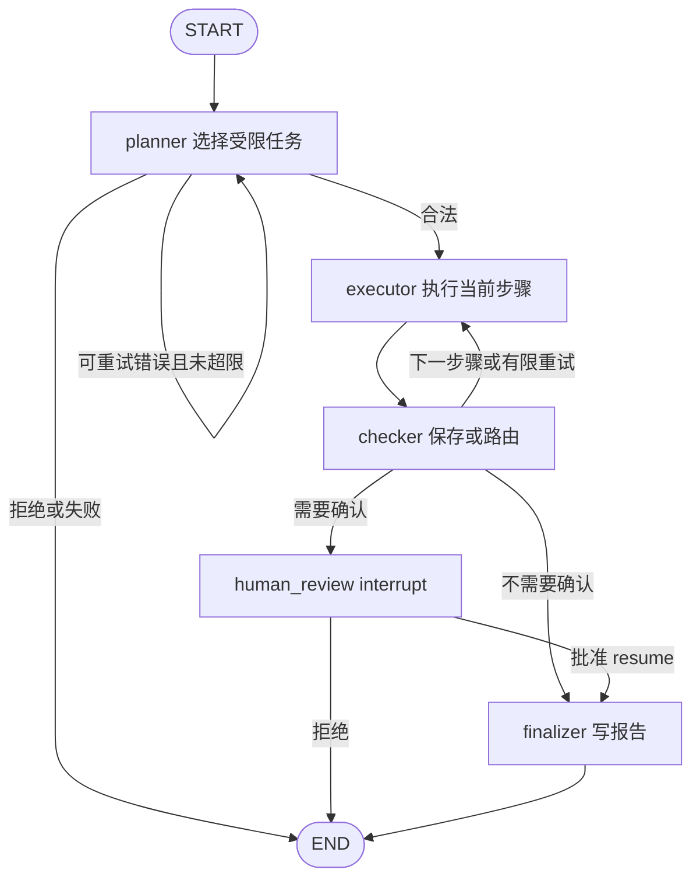

# 工程说明

README 讲评测和结论，这里讲系统本身：怎么运行、流程怎么走、数据和请求怎么处理，以及哪些事没做。

## 运行

```bash
python -m venv .venv
.venv/bin/python -m pip install -r requirements-dev.txt     # Windows：.venv\Scripts\python
.venv/bin/python -m streamlit run app.py
```

界面里选「示例工单」和「离线规则」，就能不用 API 跑通整个流程。离线规则只是基线，不能证明模型能力。

使用千问时，选「通义千问」并勾选同意发送；程序读取当前进程的 `DASHSCOPE_API_KEY`，不会自动加载 `.env`（`.env.example` 只是说明）。可选环境变量：`DASHSCOPE_MODEL`（默认 `qwen-plus`）、`DASHSCOPE_BASE_URL`、`CONDITION_CHECK`（`regex` / `audit` / `both`）。真实模式会把任务、字段、类别等元数据，以及最多 12 条、每条最多 400 字符的工单正文发给阿里云。

命令行：

```bash
python -m src.cli --source csv --question "按类别统计工单数量"
python -m src.cli --source sqlite --question "未解决工单报告" --review
python -m src.cli --mode qwen --source sqlite --question "分析2026-09-02至2026-09-04的未解决工单"
```

## 工作流



- 规划成功后，程序按固定顺序执行 `inspect_csv → aggregate_csv / query_sql → summarize`，不让模型自己编排流程。
- 规划结果先校验工具名和参数结构，再按 `CONDITION_CHECK` 核对请求里的条件；不通过就拒绝，不执行。
- SQL 由程序模板生成并参数化，使用只读连接，不接收模型写的 SQL。
- 统计数字和模型生成的文字分开存放；摘要只能引用实际存在的工单 ID；没有匹配数据时不生成摘要。
- 人工确认用 LangGraph 的 `interrupt` / `Command(resume=...)` 实现，拒绝后不生成报告。
- 单步最多 3 次尝试，单个任务最多 6 次模型请求，单请求默认 20 秒超时，活跃执行预算 90 秒。

## 数据格式

参考 `data/tickets_sample.csv`：恰好 8 列，UTF-8 编码，最大 2 MB、5000 条。

| 字段 | 约束 |
|---|---|
| ticket_id | 唯一，字母、数字、下划线、连字符，最多 64 字符 |
| content | 非空，最多 2000 字符 |
| category | 已有业务类别，非空；不是模型自动分类的结果 |
| channel | 渠道，非空 |
| is_resolved | true 或 false |
| response_time | 首次响应分钟数，非负数或空 |
| rating | 1 至 5 的整数或空；空评分不补零 |
| created_at | YYYY-MM-DD |

## 请求幂等

`--request-id`（或 `runner.run(..., request_id=...)`）可以复用业务操作编号。请求指纹由问题、数据 SHA-256、数据来源、审批选项、模型、提示版本和执行配置组成，登记在本地 SQLite（`.runtime/requests.sqlite3`）：

- 同一编号、同样参数：直接返回原结果，不重新规划，也不重新生成报告。
- 同一编号、不同参数：在调用模型之前就报 `IDEMPOTENCY_CONFLICT`。
- 执行中重复提交：只允许一个执行者，其他提交返回 `REQUEST_IN_PROGRESS`。
- 结果不明（例如文件已写成但登记失败）：保留为不可自动重试的状态，需要人工检查。

`InMemorySaver` 只在当前进程内保留检查点，进程重启后，暂停中的任务无法继续。这套机制不保证第三方模型 API 的 exactly-once。

## 测试

```bash
python -m pytest        # 工作流、条件审计判定表、正则校验、幂等、并发、故障注入、界面
python -m ruff check .
python -m src.evaluate --source csv      # 离线规则的固定任务验收
```

测试不调模型。它们证明的是代码行为，不代表模型准确率，也不代表生产可用性。

## 没做的事

只有三种只读任务，不是通用 Agent 或任意 NL2SQL。摘要引用校验只能排除不存在的 ID，不能证明每句话都有原文支持。没有登录、租户隔离和加密，不适合多用户公网部署。没有接入真实工单平台，也没有发信、退款、改库等写操作。
